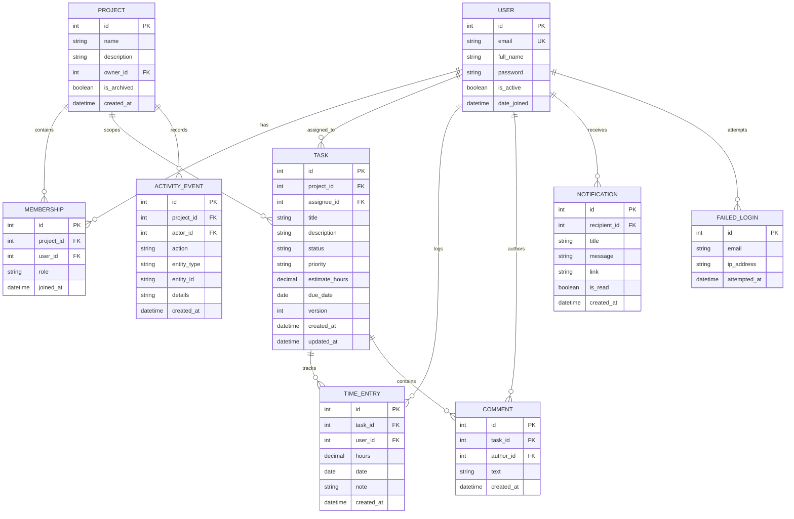

# Software Architecture Document (SAD v1.1)
**Project 27: Project Management System**  
**Course:** Software Engineering Mini-Project  
**Deliverable Reference:** DOC-01 (Issue #39)  
**Author / Architecture Contributor:** Shravankumar Patil (`PES1UG24CS692`, `@shravanakumarpatil-123`)  
**Team Members (Group 27):**
- **Tilak** (`PES1UG24CS696`)
- **Shravankumar Patil** (`PES1UG24CS692`)
- **Sachin** (`PES1UG24CS688`)
- **Prasanna** (`PES1UG24CS684`)

---

## 1. Architectural Overview & Design Principles

The Project Management System is built using a **layered monolithic architecture** structured around Django's Model-View-Template (MVT) design pattern. This architecture was selected to achieve optimal cohesion, minimize distributed failure modes, ensure strict transactional atomicity, and deliver rapid sub-50ms server-side execution without microservice network overhead.

### Architectural Tiers:
```
+-----------------------------------------------------------------------+
|                        Presentation Tier                              |
|  - Responsive HTML5 / CSS3 Grid & Flexbox                             |
|  - Accessible Vanilla JavaScript Controller (board.js)                |
|  - Modal Dialogs, ARIA Landmarks, and Focus Management (NFR-05)       |
+-----------------------------------------------------------------------+
                                  | HTTP / JSON (CSRF Protected)
                                  v
+-----------------------------------------------------------------------+
|                        Application & View Tier                        |
|  - Role-Based Access Control Decorators (@require_project_membership) |
|  - RESTful JSON API Handlers & Traditional Form Endpoints             |
|  - Service Layer (audit/services.py, notifications/services.py)       |
|  - Optimistic Concurrency Engine (Version Verification)               |
+-----------------------------------------------------------------------+
                                  | Django ORM / Transactions
                                  v
+-----------------------------------------------------------------------+
|                         Data & Persistence Tier                       |
|  - Relational Database Engine (SQLite / PostgreSQL)                   |
|  - Compound Indexes (project + created_at, email + attempted_at)       |
|  - ACID Transactional Atomicity (django.db.transaction.atomic)        |
+-----------------------------------------------------------------------+
```

---

## 2. Component & System Modules Breakdown

The codebase is partitioned into five focused Django applications, each enforcing strict single-responsibility boundaries:

### 2.1 `accounts` (Identity & Security Module)
- **Custom User Model (`User`)**: Employs normalized, case-insensitive email addresses as primary credentials instead of arbitrary usernames.
- **Credential Storage (`SR-02`)**: Hashes passwords using PBKDF2 with SHA-256 and per-user cryptographic salts.
- **Brute-Force Rate Limiting (`SR-05`)**: Enforces a sliding-window lockout policy. After 5 consecutive failed sign-in attempts within 15 minutes, subsequent authentication attempts are rejected with HTTP 429 Too Many Requests, RFC 6585 `Retry-After` headers, and structured JSON retry metadata.
- **Session Lifecycle (`FR-02`)**: Secure session establishment, session fixation rotation (`cycle_key()`), and cookie destruction upon sign-out.

### 2.2 `projects` (Multi-Tenant Workspace & Authorization Module)
- **Project Isolation (`FR-03`)**: Workspaces scope tasks, memberships, and activity events.
- **Role-Based Access Control (`FR-04`, `SR-01`)**: Defines three hierarchical roles:
  - `Owner`: Workspace creator with full administrative rights (member invitation, role alteration, project archival).
  - `Manager`: Elevated member capable of creating tasks, altering estimates, and assigning tasks.
  - `Member`: Standard contributor capable of viewing project assets, moving tasks along the Kanban workflow, logging time, and posting comments.
- **Archival Protection (`FR-16`)**: Freezes workspaces into read-only mode upon archival. Any mutation requests against archived projects are intercepted and rejected with HTTP 409 Conflict.

### 2.3 `tasks` (Workflow & Effort Tracking Engine)
- **Kanban Board Lifecycle (`FR-07`)**: Manages the 5 canonical workflow columns: `Backlog` &rarr; `To Do` &rarr; `In Progress` &rarr; `Review` &rarr; `Done`.
- **Optimistic Concurrency Control**: Task records track integer version counters. Status mutations verify `expected_version == current_version` prior to saving. Concurrent updates return HTTP 409 Conflict.
- **Effort Estimation (`FR-09`)**: Validates non-negative hour estimates restricted strictly to 0.5-hour increments.
- **Time Logging (`FR-10`, `FR-11`)**: Records atomic time entries with 0.25-hour granularity, recomputing actual hours dynamically.
- **CSV Data Export (`FR-15`)**: Streams project task records in RFC 4180 compliant comma-separated formatting.

### 2.4 `audit` (Transactional History & Traceability)
- **Activity Stream (`FR-13`)**: Transactional logging of entity mutations (`TASK_CREATED`, `TASK_EDITED`, `TASK_MOVED`, `MEMBER_INVITED`, `PROJECT_ARCHIVED`).
- **Atomicity Guarantees (`NFR-03`)**: Log entries execute inside the same `transaction.atomic()` block as the underlying mutation, guaranteeing zero unrecorded operations or orphaned logs.

### 2.5 `notifications` (In-App Messaging Engine)
- **Direct Alerts (`FR-17`)**: Emits transactional notifications to target users upon task assignment or project invitations.
- **User Scoping**: In-app listing and read receipts are strictly scoped to the authenticated recipient.

---

## 3. Database Schema & Entity-Relationship Architecture

The entity relationships are captured in the following Mermaid ER diagram:



---

## 4. API Interface & RESTful Endpoint Contracts

All mutation endpoints require standard CSRF verification via the `X-CSRFToken` request header.

| Endpoint URI | HTTP Method | Required Role | Request Payload | Response Schema | Status Codes |
| :--- | :--- | :--- | :--- | :--- | :--- |
| `/accounts/register/` | `POST` | Anonymous | `{"email", "password", "full_name"}` | `{"id", "email", "full_name", "message"}` | `201`, `400` |
| `/accounts/login/` | `POST` | Anonymous | `{"email", "password"}` | `{"id", "email", "full_name", "message"}` | `200`, `400`, `401`, `429` |
| `/accounts/logout/` | `POST`/`GET` | Authenticated | None | `{"message": "Logged out successfully"}` | `200`, `302` |
| `/projects/` | `GET` | Authenticated | None | `{"projects": [...]}` | `200` |
| `/projects/` | `POST` | Authenticated | `{"name", "description"}` | `{"id", "name", "role", "created_at"}` | `201`, `400` |
| `/projects/<id>/archive/` | `POST` | `Owner` | None | Redirect or `{"message": "Archived"}` | `302`, `403`, `409` |
| `/projects/<id>/members/` | `POST` | `Owner` | `{"email", "role"}` | `{"id", "user_email", "role", "message"}` | `201`, `400`, `403` |
| `/tasks/projects/<id>/tasks/` | `GET` | Member+ | Query params: `q`, `assignee`, `priority`, `due_status` | `{"tasks": [...]}` | `200`, `403` |
| `/tasks/projects/<id>/tasks/` | `POST` | `Manager`/`Owner` | `{"title", "description", "priority", "estimate_hours", "assignee_id", "due_date"}` | Task Object (`id`, `title`, `version`, ...) | `201`, `400`, `403`, `409` |
| `/tasks/projects/<id>/tasks/<tid>/` | `GET` | Member+ | None | Full Task Details + Comments + TimeLogs | `200`, `403`, `404` |
| `/tasks/projects/<id>/tasks/<tid>/` | `PATCH` | Member (assigned) / Manager+ | `{"title", "description", ...}` | Updated Task Object | `200`, `400`, `403`, `409` |
| `/tasks/projects/<id>/tasks/<tid>/status/` | `PATCH` | Member+ | `{"status", "expected_version"}` | `{"id", "status", "version"}` | `200`, `400`, `403`, `409` |
| `/tasks/projects/<id>/tasks/<tid>/time/` | `POST` | Member+ | `{"hours", "note"}` | TimeEntry Object | `201`, `400`, `403` |
| `/tasks/projects/<id>/tasks/<tid>/comments/` | `POST` | Member+ | `{"text"}` | Comment Object | `201`, `400`, `403` |
| `/tasks/projects/<id>/dashboard/` | `GET` | Member+ | None | Metrics Object (`total_tasks`, `overdue_count`, `estimated_hours`, `actual_hours`) | `200`, `403` |
| `/tasks/projects/<id>/tasks.csv` | `GET` | `Manager`/`Owner` | None | RFC 4180 CSV binary stream | `200`, `403` |

---

## 5. Security & Concurrency Architecture

1. **Server-Side Authorization Boundary (`SR-01`)**: Security is enforced centrally on the server via the `@require_project_membership` decorator rather than relying on client-side state.
2. **Output Sanitization & Injection Defense (`SR-04`)**:
   - Django's contextual template auto-escaping prevents Cross-Site Scripting (XSS).
   - All client-side text insertions in `board.js` pass through `escapeHtml()` prior to DOM injection.
   - Database queries leverage Django ORM's parameterized query engine, guaranteeing immunity against SQL injection.
3. **Optimistic Locking & Concurrency (`SAD §3.7`)**:
   - Status updates require matching `expected_version`.
   - Protects multi-user drag-and-drop operations from blind overwriting.
4. **Keyboard Accessibility (`NFR-05`)**:
   - Full keyboard operability via skip links (`.skip-link`), focus rings (`:focus-visible`), card activation (`Enter`/`Space`), accessible modal status selector (`#modal-status-select`), and modal dismissal (`Escape`).
